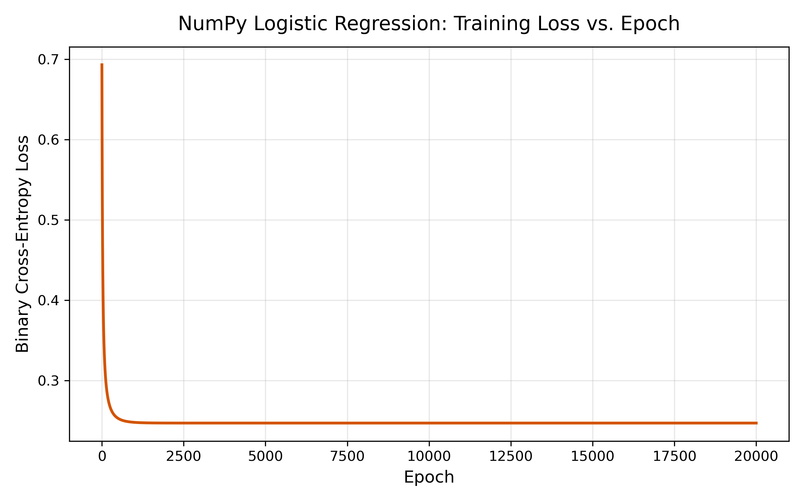

# Breast Mass Classification: Logistic Regression & Decision Thresholds
**Author:** Ignacio Flores III  
**Course:** MBSA 265: Machine Learning Pathway  

This project implements binary logistic regression using manual NumPy gradient descent and compares it against an unregularized Scikit-learn estimator and a majority baseline on the Wisconsin Diagnostic Breast Cancer dataset.

---

## 1. Project Overview & Findings
* **Objective:** Predict breast mass malignancy (**1 = Malignant**, **0 = Benign**) using two standardized features: `mean radius` and `mean texture`.
* **Equivalence:** NumPy gradient descent converged to within $1.19 \times 10^{-10}$ mean absolute probability difference of Scikit-learn (`C=inf`).
* **Thresholding:** Validation tuning selected an optimal decision threshold of $\tau = 0.60$, prioritizing precision ($90.32\%$) with an $F_1$ of $0.7671$ on the test set.
* **Scope:** Educational modeling prototype only; non-clinical.

---

## 2. Directory Structure
```text
Project_02_Classification/
├── logistic_regression_analysis.py  # End-to-end training and evaluation script
├── memo.md                          # Detailed research memo and report
├── assignment_requirements.txt      # Dependency specification
├── reports/
│   ├── training_loss.png            # NumPy BCE loss vs. epoch curve
│   ├── threshold_results.csv        # Validation metric scan across 7 thresholds
│   └── assignment_results.csv       # 10 configuration rows (Validation & Test)
└── README.md                        # Reproduction guide

---

---

## 3. Reproduction Instructions

### Option A: macOS Terminal
1. Open **Terminal** (`Applications > Utilities > Terminal`).
2. Clone repository and navigate to the project directory:
   ```bash
   git clone [https://github.com/Ignacio-Flores-III/MBSA265.git](https://github.com/Ignacio-Flores-III/MBSA265.git)
   cd MBSA265/machine-learning-pathway/Project_02_Classification
   ```
3. Set up and activate virtual environment:
   ```bash
   python3 -m venv .venv
   source .venv/bin/activate
   ```
4. Install dependencies:
   ```bash
   pip install -r assignment_requirements.txt
   ```
5. Execute the analysis pipeline:
   ```bash
   python logistic_regression_analysis.py
   ```

### Option B: Windows PowerShell
1. Open **PowerShell** (Start Menu > search "PowerShell").
2. Clone repository and navigate to the project directory:
   ```powershell
   git clone [https://github.com/Ignacio-Flores-III/MBSA265.git](https://github.com/Ignacio-Flores-III/MBSA265.git)
   cd MBSA265\machine-learning-pathway\Project_02_Classification
   ```
3. Create and activate virtual environment (bypassing execution restriction):
   ```powershell
   python -m venv .venv
   Set-ExecutionPolicy -Scope Process -ExecutionPolicy Bypass
   .\.venv\Scripts\Activate.ps1
   ```
4. Install dependencies:
   ```powershell
   python -m pip install -r assignment_requirements.txt
   ```
5. Execute the analysis pipeline:
   ```powershell
   python logistic_regression_analysis.py
   ```

---

## 4. Expected Output & Runtime
* **Runtime:** Approximately 3–5 seconds.
* **Generated Files:**
  * `reports/training_loss.png`
  * `reports/threshold_results.csv`
  * `reports/assignment_results.csv`

### NumPy BCE Training Convergence


* **Test Performance Summary:**
  * Baseline (Default 0.50): Accuracy = 63.16%, F1 = 0.0000
  * NumPy Logistic (Default 0.50): Accuracy = 86.84%, F1 = 0.8052
  * NumPy Logistic (Selected 0.60): Accuracy = 85.09%, F1 = 0.7671

---

## 5. Troubleshooting
* **`command not found: python3`**: Verify Python is added to your PATH environment variable.
* **`ModuleNotFoundError`**: Confirm virtual environment is activated before running the script.